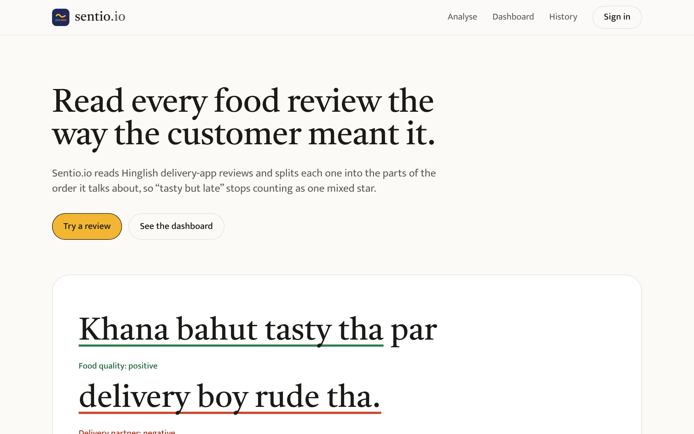
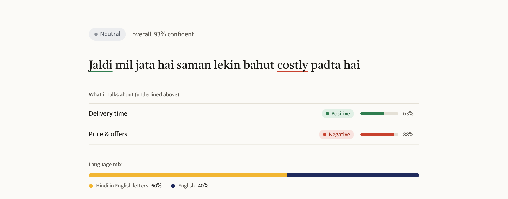
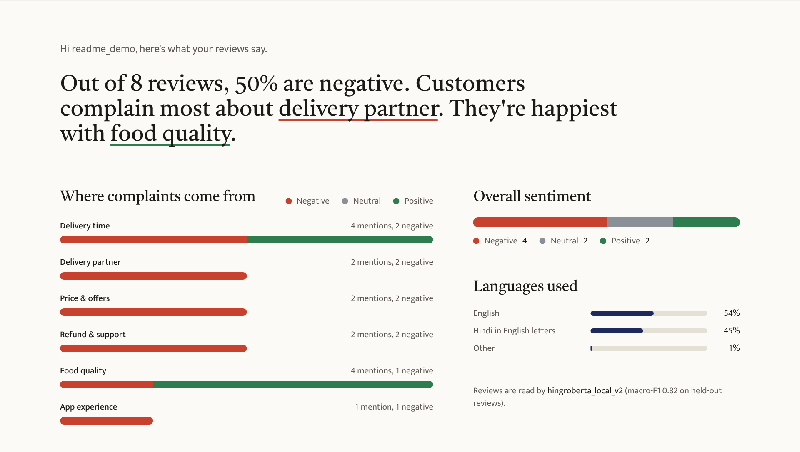
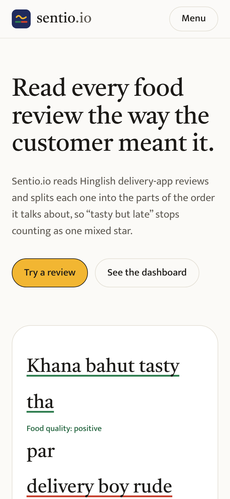

# Sentio.io

**Aspect-based sentiment analysis for Hinglish food delivery reviews.**



## Description

Food delivery apps in India get thousands of reviews written in **Hinglish**, a mix of Hindi and
English, usually typed in English letters:

> *"Khana bahut tasty tha par delivery boy rude tha"*

A star rating gives this review one number, but the customer is happy with the food and unhappy
with the delivery partner. English-only models miss the Hindi words, and Hindi models miss the
English ones.

**Sentio.io** reads each review the way the customer meant it. It gives the overall sentiment
**and** a separate verdict for every part of the order the review talks about, so a business can
see exactly what customers are complaining about.

We built it because no public dataset or tool covered Hinglish food delivery reviews by aspect,
so we collected and labelled our own data and trained a model on it.

## Features

- **Overall sentiment** of a review: positive, negative or neutral, with a confidence score.
- **Seven aspects**, each with its own verdict: delivery time, food quality, packaging,
  delivery partner, app experience, price & offers, refund & support.
- **Highlights** the phrase behind each aspect and shows which words influenced the model.
- **Language mix** of each review: English, Hindi in English letters, Devanagari, emoji.
- **Bulk analysis:** paste up to 50 reviews or upload a CSV, see the top complaints and download the results.
- **Knows when it's unsure:** low-confidence answers are marked "Not sure", and anyone can correct a result with 👍 / 👎.
- **Accounts** with a private history and a dashboard of what your reviews complain about.
- **Works on phone and laptop.**

## Technologies Used

| Area | Tools |
|---|---|
| Model | Python, PyTorch, Hugging Face Transformers, HingRoBERTa (`l3cube-pune/hing-roberta`) |
| Data and evaluation | pandas, scikit-learn, google-play-scraper |
| Backend | FastAPI, SQLAlchemy, PostgreSQL, JWT login, bcrypt |
| Frontend | React, Vite, Tailwind CSS, React Router |
| Testing | pytest, pip-audit, npm audit |
| Hosting | Vercel, Render, Neon, ngrok |

### Model results

Scored on 277 reviews the models never saw during training:

| Model | Overall macro-F1 | Accuracy |
|---|---|---|
| Always "negative" (baseline) | 0.304 | 0.838 |
| TF-IDF + Logistic Regression | 0.670 | 0.859 |
| mBERT | 0.635 | — |
| XLM-RoBERTa | 0.598 | — |
| **HingRoBERTa (used in Sentio.io)** | **0.817** | **0.921** |

The dataset has **2,291 hand-labelled reviews**, with inter-annotator agreement of
**Cohen's κ = 0.83**. Full details: [ML/results/RESULTS.md](ML/results/RESULTS.md)

## Installation

**You need:** Python 3.12, Node.js 20 or newer, PostgreSQL. An NVIDIA GPU is optional.

**1. Download the project**
```bash
git clone https://github.com/shrmilamango/sentio.io.git
cd sentio.io
```

**2. Database** — create a PostgreSQL database named `sentio`.
Tables are created automatically the first time the backend starts.

**3. Backend**
```bash
cd api
python -m venv venv
venv\Scripts\activate              # macOS / Linux: source venv/bin/activate
pip install -r requirements.txt
copy .env.example .env             # macOS / Linux: cp .env.example .env
```
Open `api/.env` and set your PostgreSQL password and a long random `JWT_SECRET`.

**4. Model**
```bash
cd ML
python setup_ml_env.py             # creates ML\venv and installs PyTorch for your GPU or CPU
python train.py --model l3cube-pune/hing-roberta --tag hingroberta_local_v2 --splits splits_v2
```
Training saves the model to `ML/models/hingroberta_local_v2/`. The trained model is not in the
repository because it is 1.1 GB.

> No model yet? Set `USE_FAKE_MODEL=True` in `api/.env` to run the app with a simple keyword placeholder.

**5. Frontend**
```bash
cd frontend
npm install
```

## Usage

Start the three parts, each in its own terminal, in this order:

```bash
# 1. Model service  (port 8001)
cd ML
venv\Scripts\python serve.py --tag hingroberta_local_v2

# 2. Backend API    (port 8000, docs at http://localhost:8000/docs)
cd api
venv\Scripts\python -m uvicorn app.main:app --reload

# 3. Website        (port 5173)
cd frontend
npm run dev
```

Then open **http://localhost:5173**:

1. Paste a review, for example *"Refund 10 din se nahi aaya, support bekar hai"*, and click **Analyse review**.
2. Create an account to keep your reviews.
3. Open **Bulk** to analyse up to 50 reviews at once, or upload a CSV.
4. Open **Dashboard** to see which parts of the order get the most complaints, and **History** to browse past reviews.

**Run the tests**
```bash
cd api
pip install -r requirements-dev.txt
python -m pytest -q
```

## Screenshots

**Analysing a review** — overall sentiment plus a verdict for each aspect:



**Dashboard** — what your reviews complain about most:



**On a phone:**



## Project Structure

```
sentio.io/
├── frontend/              React website
│   └── src/
│       ├── pages/         Home, Analyse, Sign in / Register, Dashboard, History
│       ├── components/    Result view, highlighted review text, page layout
│       └── lib/           API calls, login state, aspect names and colours
│
├── api/                   Backend (FastAPI)
│   ├── app/
│   │   ├── main.py        all API routes
│   │   ├── auth.py        password hashing, login tokens, protected routes
│   │   ├── models.py      database tables
│   │   ├── schemas.py     request and response formats
│   │   ├── ml_client.py   talks to the model service
│   │   ├── ratelimit.py   limits on logins, sign-ups and analyses
│   │   └── config.py      settings read from .env
│   └── tests/             58 automated tests
│
├── ML/                    Model training and serving
│   ├── split_dataset.py   splits data into train / validation / test (70 / 15 / 15)
│   ├── baseline.py        TF-IDF + Logistic Regression baseline
│   ├── train.py           fine-tunes a transformer (overall + 7 aspect outputs)
│   ├── serve.py           model service used by the backend
│   ├── colab/             notebook for training on Google Colab
│   └── results/           scores, predictions and RESULTS.md
│
├── Dataset/
│   ├── sentio_dataset_v2.csv   final dataset: 2,291 labelled reviews
│   ├── annotation/             labelling sheets and agreement report
│   └── *.py                    scraping, filtering and agreement scripts
│
├── docs/screenshots/      images used in this README
├── render.yaml            backend hosting settings
└── DEPLOY.md              free deployment guide
```

Kept out of the repository by `.gitignore`: `.env` files, the trained model, raw scraped data,
`venv` and `node_modules`.

## Future Improvements

- **Sarcasm detection**, for reviews like *"wah kya service hai, 2 ghante late"*.
- **More positive and neutral reviews** in the dataset, which are rarer than complaints.
- **Better packaging detection**, currently the weakest aspect because few reviews mention it.
- **More Devanagari training data.**
- **Use the 👍 / 👎 corrections** to retrain the model on the cases it gets wrong.
- **Smaller, faster model** (quantised) so it can run on free cloud servers without a laptop.
- **OTP login** by phone or email.

## Author

- **Shyam Sundar Prajapati** — [@shrmilamango](https://github.com/shrmilamango)
- **Shreya Singh**
- **Shivman Vadwan**

## License

Copyright © 2026 Shyam Sundar Prajapati, Shreya Singh and Shivman Vadwan. All rights reserved.

This code is not open source. Please contact the authors before using or sharing it.
